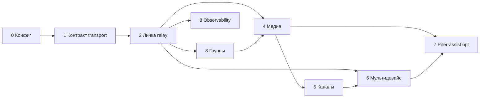

# Пошаговое внедрение (фазы)

Каждая фаза заканчивается чётким **результатом** (работающий контракт + тесты / ручная проверка). Фазы можно сжимать, но порядок лучше не переворачивать: сначала контракт и политики, потом типы сообщений и каналы.

**Область:** все фазы ниже относятся к **нативному серверу Chatus** (REST, WebSocket чата, SQLite-очередь клиента). Интеграция **Telegram** в одном списке чатов не меняет эти этапы; см. [06-unified-inbox-telegram-scope.md](./06-unified-inbox-telegram-scope.md).

---

## Фаза 0 — Продуктовые решения и конфигурация сервера

**Цель:** зафиксировать правила без написания P2P-транспорта.

- Решить минимальные гарантии: что обязан хранить сервер (текст / метаданные / медиа / как долго).
- Описать профили: например «экономия» vs «как классический мессенджер» (вместо десятков ручек в UI на старте).
- Заложить **переменные окружения** или конфиг NestJS: TTL текстового кэша, TTL медиа, «удалять после доставки всем устройствам» vs «хранить N часов».
- **Встраивание:** новый модуль конфигурации в `server/src/config` или `.env` + чтение в `MessagesService` / будущем «mailbox» сервисе (на первом шаге может быть только документированная заготовка).

**Выход:** документ решений + список env; опционально заглушки чтения конфига в коде. Черновик имён переменных: [05-env-and-config.md](./05-env-and-config.md).

---

## Фаза 1 — Единый контракт `transport` и маппинг клиент ↔ сервер

**Цель:** одно значение по всей цепочке.

- Сервер уже использует Prisma enum `Transport`: `p2p` | `websocket`.
- Клиент SQLite: поле `messages.transport` сейчас **`server`** — спланировать миграцию на **`websocket`** / **`p2p`** или явный маппинг при синке (`server` → `websocket`).
- REST мапперы (`server/src/common/mappers.ts`) и ответы API должны отдавать transport клиенту.
- При получении сообщения по WebSocket клиент сохраняет тот же флаг в `MessageDao`.

**Встраивание:**

- `messages.service.ts` — установка `transport` при создании.
- Мапперы сообщений на сервере и типы в `mobile/src/stores/types.ts` / DAO.

**Выход:** согласованная таблица значений + миграция SQLite при необходимости; все новые сообщения помечаются корректно.

**Реализация:** контракт зафиксирован как `websocket` / `p2p`. Клиентский `normalizeMessageTransport` принимает legacy `server` / `ws` и сохраняет `websocket`; SQLite `DB_VERSION=13` обновляет существующие строки с legacy/null transport.

---

## Фаза 2 — Приватный чат 1:1: «relay-first» без изменения UX

**Цель:** поведение как сейчас (WebSocket + очередь), но архитектурно подготовить слой «mailbox».

- Фактически оставить доставку через `WebsocketGateway` + `RealtimeService`.
- Добавить на сервере **явную** семантику статусов и при необходимости отдельную таблицу «непрочитанные дубликаты для второго устройства» только если это уже в ТЗ — иначе отложить до фазы мультидевайса.

**Встраивание:** минимальные изменения в `createMessage` и событиях ack/read, если нужны для политики удаления из кэша.

**Выход:** регрессия 1:1 текста и медиа без изменений UI.

---

## Фаза 3 — Групповые чаты под теми же правилами

**Цель:** расширить политику кэша на `ChatType.group`.

- Fan-out уже есть (`broadcastToChatMembers`).
- Добавить параметры TTL / медиа по типу чата (конфиг фазы 0).

**Встраивание:** `ChatsService` / места создания групп — только если появятся per-chat overrides; иначе всё в общем сервисе сообщений.

---

## Фаза 4 — Медиа: политики по типам сообщений

**Цель:** для каждого типа определить **где живёт blob** и **когда клиент может перезапросить**.

Работать по чеклисту из [04-message-types-and-media.md](./04-message-types-and-media.md).

Общие точки:

- Загрузки: `apiUpload`, `apiUploadVoice`, обработка 413 в `TransportService`.
- Очередь: все ветки `SyncService` для `send_message_*`.
- Опционально: фоновая загрузка / докачка файла при появлении `remote_url`.

**Выход:** матрица «тип сообщения × режим кэша × поведение офлайна».

---

## Фаза 5 — Каналы (посты)

**Цель:** отдельная политика retention и доставки подписчикам.

- Сейчас посты создаются через `createChannelPost` с `transport: websocket`.
- Нужно явно решить: минимальный срок хранения постов и медиа на сервере, поведение для **нового** подписчика (история с сервера vs peer-assist — последнее для каналов обычно слабее).

**Встраивание:** `channels.service.ts`, события `onChannelPost` на клиенте, возможно индексация последних N постов.

---

## Фаза 6 — Мультидевайс и «ресинк через контакты»

**Цель:** новое устройство получает историю предсказуемо.

- Первичный путь: **серверный бэкап** или синхронизация между своими сессиями.
- Peer-assisted: только как **ускоритель / дополнение**, с явными фолбэками если контакт не может отдать дубликат.

**Встраивание:** `AuthService` / стартовый `SyncService.fullSync`, возможно новые REST методы «запросить недостающий диапазон сообщений».

---

## Фаза 7 (опционально) — Настоящий peer-assist или DataChannel для данных чата

**Цель:** только после стабильного relay.

- Отдельный протокол поверх существующего signaling или новый слой.
- Не смешивать с **SignalingService** для звонков без архитектурного spike.

---

## Фаза 8 — Наблюдаемость и админка

**Цель:** метрики очередей, размер кэша медиа, ошибки доставки.

- Расширение логов NestJS или простой internal endpoint — по необходимости.

---

### Зависимости между фазами

