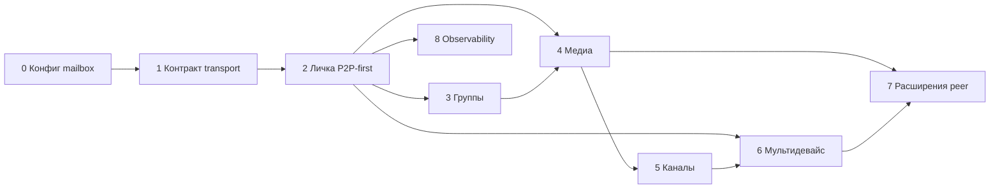

# Пошаговое внедрение (фазы)

Каждая фаза заканчивается чётким **результатом** (работающий контракт + тесты / ручная проверка).

**Целевая архитектура:** [P2P-first](./01-terminology-and-principles.md) для лички 1:1 — **сначала peer**, сервер — **mailbox при офлайне / ошибке peer / политике**. Текущий код пока **server-first**; фазы переводят продукт к цели.

**Область:** нативный сервер Chatus и клиент. **Telegram** сюда не входит; см. [06-unified-inbox-telegram-scope.md](./06-unified-inbox-telegram-scope.md).

---

## Фаза 0 — Продуктовые решения и конфигурация сервера

**Цель:** правила для **данных, которые попали на сервер** (фолбэк mailbox), без обязательной реализации peer-кода.

- Таймауты попытки peer до перехода на сервер; что логируем (метрика peer vs fallback).
- Минимальные гарантии mailbox: текст / метаданные / медиа / как долго хранить после забора получателем.
- **Переменные окружения** / NestJS: TTL, `RELAY_*`, удаление после ack всех устройств — см. [05-env-and-config.md](./05-env-and-config.md).
- **Встраивание:** конфиг в `server/src/config` или `.env` + сервис mailbox / `MessagesService` по мере готовности.

**Выход:** зафиксированные решения + черновик env.

---

## Фаза 1 — Единый контракт `transport` и маппинг клиент ↔ сервер

**Цель:** одно значение по всей цепочке; семантика понятна пользователю и логам.

- Prisma enum `Transport`: **`p2p`** — сообщение доставлено/учтено по **peer-пути**; **`websocket`** — через **серверный relay / mailbox** (включая бывший «всегда сервер»).
- Клиент SQLite: выровнять `messages.transport` с API (`server` → устаревший синоним для `websocket` при миграции).
- REST/WebSocket мапперы отдают `transport`; при приёме сообщения клиент сохраняет флаг в `MessageDao`.

**Выход:** согласованная таблица значений + миграция SQLite при необходимости.

---

## Фаза 2 — Личка 1:1: попытка P2P-first, fallback на сервер (mailbox)

**Цель:** для двух онлайн-пользователей — **сначала** установить peer-доставку (Data Channel или согласованный протокол); если не вышло или получатель офлайн — **тот же UX**, что сейчас: сообщение уходит на сервер, кладётся в БД, рассылается по WS при подключении получателя.

- Клиент: оркестратор «peer attempt → таймаут → `send_message` как сейчас».
- Сервер: без изменения контракта fallback-пути на первом шаге; опционально endpoint «положить только в mailbox» если отделите от полного `createMessage`.
- Логирование доли успешных peer vs fallback для подстройки таймаутов и NAT.

**Выход:** в 1:1 виден реальный peer-путь там, где сеть позволяет; при офлайне получатель получает сообщение **с сервера** после входа в сеть (mailbox).

---

## Фаза 3 — Групповые чаты под теми же правилами

**Цель:** расширить политику кэша на `ChatType.group`.

- Fan-out уже есть (`broadcastToChatMembers`).
- Добавить параметры TTL / медиа по типу чата (конфиг фазы 0).

**Встраивание:** `ChatsService` / места создания групп — только если появятся per-chat overrides; иначе всё в общем сервисе сообщений.

---

## Фаза 4 — Медиа: политики по типам сообщений

**Цель:** для каждого типа определить **где живёт blob** и **когда клиент может перезапросить**.

Работать по чеклисту из [04-message-types-and-media.md](./04-message-types-and-media.md).

Общие точки:

- Загрузки: `apiUpload`, `apiUploadVoice`, обработка 413 в `TransportService`.
- Очередь: все ветки `SyncService` для `send_message_*`.
- Опционально: фоновая загрузка / докачка файла при появлении `remote_url`.

**Выход:** матрица «тип сообщения × режим кэша × поведение офлайна».

---

## Фаза 5 — Каналы (посты)

**Цель:** отдельная политика retention и доставки подписчикам.

- Сейчас посты создаются через `createChannelPost` с `transport: websocket`.
- Нужно явно решить: минимальный срок хранения постов и медиа на сервере, поведение для **нового** подписчика (история с сервера vs peer-assist — последнее для каналов обычно слабее).

**Встраивание:** `channels.service.ts`, события `onChannelPost` на клиенте, возможно индексация последних N постов.

**Текущий срез реализации:** `computeChannelPostPolicy` резолвит retention/fanout policy для постов канала; `ChannelsService` применяет её на publish/broadcast path без изменения дефолтного поведения.

---

## Фаза 6 — Мультидевайс и «ресинк через контакты»

**Цель:** новое устройство получает историю предсказуемо.

- Первичный путь: **серверный бэкап** или синхронизация между своими сессиями.
- Peer-assisted: только как **ускоритель / дополнение**, с явными фолбэками если контакт не может отдать дубликат.

**Встраивание:** `AuthService` / стартовый `SyncService.fullSync`, возможно новые REST методы «запросить недостающий диапазон сообщений».

---

## Фаза 7 (опционально) — Расширения peer: группы, мульти-хоп, доп. оптимизации

**Цель:** после стабильного **P2P-first в личке** и mailbox.

- Peer-assist в группах (частичная раздача), улучшение NAT, дополнительные режимы — только если продукт приоритизирует.
- Не смешивать signaling звонков и сообщений без явного разделения сессий в коде.

---

## Фаза 8 — Наблюдаемость и админка

**Цель:** метрики очередей, размер кэша медиа, ошибки доставки.

- Расширение логов NestJS или простой internal endpoint — по необходимости.

---

### Зависимости между фазами

