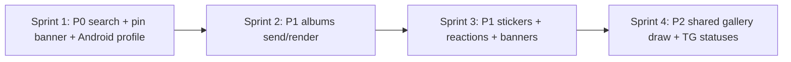

# Telegram: приоритеты и порядок работ

Краткая дорожная карта по пробелам из [gaps-vs-chatus-chat.md](./gaps-vs-chatus-chat.md). Детальные фазы UI (статусы, типы контента) — в [telegram-chat-ui-parity.md](../tasks/telegram-chat-ui-parity.md).

---

## P0 — UX канала и любого TG-чата

**Цель:** закрыть то, что пользователь замечает сразу.

| Задача | Ожидаемый результат | Основные файлы |
|--------|---------------------|----------------|
| Поиск в чате | Поле поиска, фильтр ленты, счётчик совпадений, скролл к match | `TelegramChatScreen.tsx`, переиспользовать паттерн `ChatScreen` + `ChatTopBanners` |
| Баннер закреплённого | Видимый pin, тап → scroll, закрытие → unpin | `ChatTopBanners.tsx`, `useTelegramChatMenu` / TDLib unpin |
| Android-шапка → профиль | Тап по title канала/группы открывает `TelegramChatProfile` | `CustomAndroidChatHeader.tsx` или колбэк из `TelegramChatScreen` |

**Критерий готовности P0:** подписчик канала может найти пост по тексту; админ видит закреп; с Android открывается профиль канала из шапки.

**Статус (2026-05):** поиск ✅ · закреплённый баннер ✅ · Android → профиль ✅

---

## P1 — контент и социальные фичи

| Задача | Зависимости | Сложность |
|--------|-------------|-----------|
| Альбом: отправка | TDLib `sendMessageAlbum` / grouped `inputMessagePhoto` | Высокая |
| Альбом: отображение | Расширить `TelegramMessageKind`, маппинг grouped messages | Высокая |
| Стикеры TG в ленте | `messageSticker` в `tdlibMapping` + компонент | Средняя |
| Inline-реакции | Прокинуть TDLib reactions + UI как в `ChatMessageList` | Средняя |
| Voice/video note banners | `ChatTopBanners` + плеер из Chatus | Средняя |
| Theme picker в чате | `ChatThemePickerModal` + `uiStore` по `telegramChatId` | Низкая |
| Reply rules для канала | Отключить swipe/menu reply на `channelIncoming` для не-админа | Низкая |

---

## P2 — общий редактор галереи (не backlog Telegram)

Задачи ниже **одинаково отсутствуют в Chatus-чате и в Telegram** — общий `InputBar` / `GalleryPhotoPreview`. Это не пункт «чего нет в TG-канале относительно Chatus».

| Задача | Chatus | Telegram | Документ |
|--------|--------|----------|----------|
| Рисование на фото | ❌ | ❌ | `gallery_editor_plan.md` фазы 4–5 |
| Rotate/flip в crop | ❌ | ❌ | тот же план |
| Статусы исходящих (галочки) | `telegram-chat-ui-parity.md` фаза A |
| Chatus-стикеры в TG (опционально) | Продуктовое решение: только исходящие от админа |

---

## P3 — не переносим в TDLib-ветку

- WebRTC-звонки Chatus
- LineSync / offline mailbox сервера Chatus
- Админка комментариев как в `ChannelFeedScreen` (остаётся на серверном канале)

---

## Рекомендуемые спринты

| Спринт | Scope | Не делать в том же PR |
|--------|-------|------------------------|
| 1 | P0 целиком | Альбомы |
| 2 | Album send + incoming render | Стикеры + реакции |
| 3 | Stickers render, inline reactions, top banners, theme picker | Gallery draw |
| 4 | **Общее** рисование в галерее + crop rotate; статусы TG | Новые типы TDLib beyond sticker |

---

## Метрики «канал догнал Chatus-чат»цВ

Минимальный набор для **Telegram-канала**:

1. Поиск по постам работает.
2. Закреплённый пост виден в баннере.
3. Альбом из 2–10 фото отправляется и отображается как один пост.
4. Профиль канала открывается с Android-шапки.
5. Подписчик не может ответить swipe на чужой пост (только админ с `canPost`).

Остальное — улучшение паритета с личкой/группой Chatus, не блокер канала.
