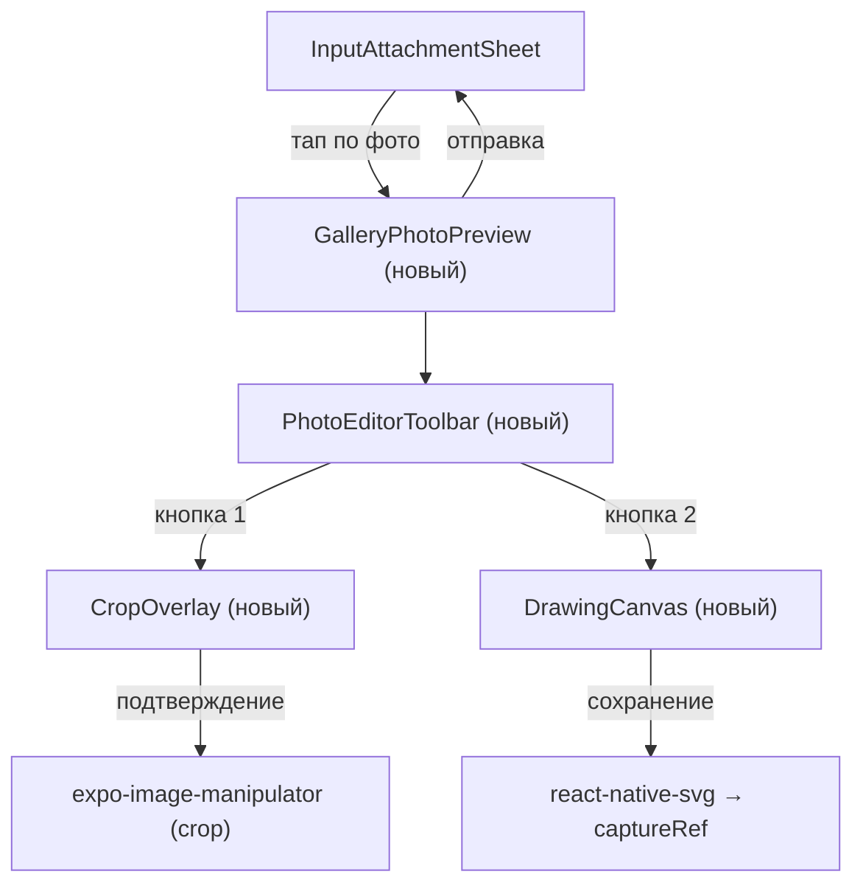

# 📸 Telegram-style Gallery Editor — Implementation Plan

## Цель
Реализовать Telegram-подобный опыт работы с фото в шторке галереи чата:
1. **Полноэкранный просмотр фото** (тап по фотке → открывается на весь экран)
2. **Свайп назад в галерею** — свайп вниз закрывает превью и возвращает в сетку галереи
3. **Мульти-выбор** с пронумерованными кружочками (уже есть ✅, нужна доработка)
4. **Input bar с подписью** — при выборе фото в превью появляется поле ввода подписи над тулбаром
5. **Тулбар редактирования** внизу с кнопками: Обрезка, Рисование
6. **Кроп-инструмент** с перетаскиваемой сеткой
7. **Рисование** карандашами/маркерами разных цветов
8. **Управление**: Отменить (undo), Очистить всё

---

## Архитектура компонентов



---

## Фаза 1: Полноэкранный просмотр фото из галереи

### Что делаем
Когда пользователь тапает по фото в сетке шторки — вместо toggle selection открывается полноэкранный просмотр. Выбор фото делается через кружочек в правом верхнем углу (он уже есть).

### Компонент: `GalleryPhotoPreview`
- **Файл**: `src/components/GalleryPhotoPreview.tsx`
- Полноэкранный Modal с чёрным фоном
- Фото по центру (resizeMode contain)
- Свайп вниз → закрытие (аналогично `ChatProfileMediaViewerModal`)
- Горизонтальный свайп → следующее/предыдущее фото (FlatList pagingEnabled)
- **Кнопка выбора** в правом верхнем углу (синий кружок с номером — как на скрине)
- **Нижний тулбар** с кнопками редактирования

### Изменения в `InputAttachmentSheet.tsx`
- **GalleryCell**: тап по фото → `onPreviewPhoto(item)` (новый колбэк)
- **Тап по кружочку** (selectCircle) → toggle selection (сохранить текущее поведение)
- Разделить зоны: касание по самой фотке = preview, касание по кружочку = select/deselect

### Задачи
- [ ] Разделить `onPress` в `GalleryCell` на два: тап по фото → preview, тап по кружочку → select
- [ ] Создать `GalleryPhotoPreview.tsx` с базовым просмотром
- [ ] Добавить кнопку выбора (кружок) в правом верхнем углу preview
- [ ] Добавить свайп вниз для закрытия
- [ ] Добавить горизонтальную навигацию по фотографиям

---

## Фаза 1.5: Свайп-возврат в галерею

### Что делаем
Когда пользователь в полноэкранном превью свайпает вниз — он **возвращается обратно в сетку галереи** (шторку), а не закрывает всё приложение. Это позволяет плавно переключаться между просмотром и выбором.

### Поведение (как в Telegram)
1. **Свайп вниз** в превью → закрывается только `GalleryPhotoPreview`, шторка `InputAttachmentSheet` остаётся открытой
2. Пользователь может продолжить скроллить/выбирать фото
3. Выбранные фото **сохраняются** при возврате
4. Повторный тап по другой фотке → снова открывается превью

### Текущая реализация
Сейчас `onClose` в `GalleryPhotoPreview` вызывает `closePreview()` → `setPreviewIndex(null)`, что уже правильно закрывает только превью, не шторку. **Это уже работает корректно ✅**

### Задачи
- [x] Свайп вниз закрывает превью, возвращает в галерею (уже реализовано)
- [ ] Добавить анимацию масштабирования при закрытии (фото «уезжает» в ячейку сетки)
- [ ] Сохранение scroll-позиции галереи при возврате из превью

---

## Фаза 2: Нижний тулбар редактирования

### Компонент: `PhotoEditorToolbar`
- **Файл**: внутри `GalleryPhotoPreview.tsx` (или отдельный файл)
- Горизонтальная полоска внизу экрана (как на скриншоте 4)
- **5 кнопок** (иконки как в Telegram):
  1. `←` Назад (закрыть preview)
  2. `⬜` **Обрезка** (crop tool)
  3. `✏️` **Рисование** (draw/annotate)
  4. `📏` **Качество/размер** (SD) — можно на потом
  5. `↑` **Отправить** (кнопка отправки)

### Дизайн (как на скриншоте)
```
┌──────────────────────────────────────┐
│  (←)    ⬜     ✏️     📏     ↑     │
│ назад  crop  draw  quality  send    │
└──────────────────────────────────────┘
```
- Фон: полупрозрачный тёмный
- Иконки: белые, 24px
- Кнопка отправки: синяя с галочкой (как в Telegram)
- Кнопка назад: `<` в кружке

### Задачи
- [ ] Создать `PhotoEditorToolbar` с 5 кнопками
- [ ] Стилизовать как в Telegram (тёмный фон, белые иконки)
- [ ] Связать кнопки с открытием соответствующих редакторов

---

## Фаза 2.5: Caption Input Bar в превью + адаптация клавиатуры

### Что делаем
Когда в полноэкранном превью **выбрана хотя бы одна фотография** (кружок синий), снизу над тулбаром появляется **поле ввода подписи** (caption input bar). При нажатии на это поле открывается клавиатура, и весь нижний блок (input bar + тулбар) **поднимается над клавиатурой**.

### Поведение (как в Telegram)
1. **Нет выбранных фото** → видны только кнопки тулбара (назад, crop, draw, send)
2. **Есть выбранные фото** → между фото и тулбаром появляется input bar:
```
┌──────────────────────────────────────┐
│           [ФОТО на весь экран]        │
│                                        │
│  ┌────────────────────────────┐  ┌──┐ │
│  │ Добавить подпись...        │  │↑ │ │
│  └────────────────────────────┘  └──┘ │
│  (←)    ⬜     ✏️     📏             │
└──────────────────────────────────────┘
```
3. **Тап на input bar** → клавиатура открывается, **весь блок** (input + toolbar) уезжает вверх:
```
┌──────────────────────────────────────┐
│           [ФОТО на весь экран]        │
│  ┌────────────────────────────┐  ┌──┐ │
│  │ Добавить подпись...        │  │↑ │ │
│  └────────────────────────────┘  └──┘ │
│  (←)    ⬜     ✏️     📏             │
├──────────────────────────────────────┤
│         [ КЛАВИАТУРА ]               │
└──────────────────────────────────────┘
```

### Технические решения для адаптации клавиатуры

#### Вариант 1: `useAnimatedKeyboard()` (Reanimated)
Уже используется в проекте (`useChatComposerKeyboardLiftStyles`). Даёт плавное перемещение:
```typescript
const keyboard = useAnimatedKeyboard();
const bottomOffset = useAnimatedStyle(() => ({
  transform: [{ translateY: -keyboard.height.value }],
}));
```

#### Вариант 2: `KeyboardAvoidingView`
Проще, но менее плавно:
```tsx
<KeyboardAvoidingView behavior="padding">
  <CaptionInput />
  <Toolbar />
</KeyboardAvoidingView>
```

#### Рекомендация
Использовать **Вариант 1** (`useAnimatedKeyboard`), т.к. он уже проверен в проекте и даёт нативную плавность.

### Компоненты
- **`PreviewCaptionBar`** — строка ввода подписи (TextInput + кнопка отправки)
  - Стиль: полупрозрачный тёмный фон, белый текст, placeholder "Добавить подпись..."
  - Кнопка отправки справа (синяя, как в Telegram)
  - `multiline`, `maxHeight: 100`

### Данные
- `captionValue` — передаётся из `InputAttachmentSheet` (уже есть `captionValue` и `onCaptionChange`)
- Синхронизация: ввод подписи в превью = то же поле, что и в шторке галереи

### Задачи
- [ ] Создать `PreviewCaptionBar` компонент (TextInput + Send button)
- [ ] Показывать caption bar только когда `selectedItems.length > 0`
- [ ] Пробросить `captionValue` и `onCaptionChange` в `GalleryPhotoPreview`
- [ ] Реализовать подъём клавиатуры через `useAnimatedKeyboard()`
- [ ] Обеспечить плавную анимацию появления/скрытия caption bar
- [ ] Синхронизация подписи между превью и шторкой галереи

---

## Фаза 3: Инструмент обрезки (Crop)

### Компонент: `CropOverlay`
- **Файл**: `src/components/CropOverlay.tsx`
- Полноэкранный оверлей поверх фото
- **Затемнение** вокруг зоны обрезки
- **Сетка 3×3** внутри зоны обрезки (Rule of Thirds)
- **8 ручек** по углам и серединам сторон для перетаскивания
- **Перемещение** всей зоны жестом (pan)
- **Кнопка "СБРОС"** внизу (как на скриншоте)
- **Циферблат** наклона снизу (rotation dial — можно упростить)

### Логика обрезки
1. Жесты через `react-native-gesture-handler` (Pan)
2. Рассчёт пропорций crop-области относительно оригинального изображения
3. При подтверждении → `expo-image-manipulator.manipulateAsync(uri, [{ crop: { ... } }])`
4. Результат: новый URI → заменяем в selected items

### Нижний тулбар в режиме crop
```
┌─────────────────────────────────────┐
│  (✕)              СБРОС       (✓)  │
│ отмена                    подтвердить│
└─────────────────────────────────────┘
```

### Задачи
- [ ] Создать `CropOverlay.tsx` с базовой рамкой
- [ ] Реализовать 8 drag-ручек (Pan gestures)
- [ ] Реализовать перетаскивание всей рамки
- [ ] Добавить затемнение за пределами рамки
- [ ] Нарисовать сетку 3×3
- [ ] Добавить кнопку СБРОС
- [ ] Интеграция с `expo-image-manipulator` для финального crop

---

## Фаза 4: Инструмент рисования (Draw)

### Компонент: `DrawingCanvas`
- **Файл**: `src/components/DrawingCanvas.tsx`
- SVG-канвас поверх фото (`react-native-svg` — уже в проекте)
- Каждый штрих = `<Path>` элемент в SVG
- Рисование пальцем → Pan gesture → сбор точек → SVG path

### Панель инструментов рисования (нижняя)
Как на скриншоте 3:
```
┌─────────────────────────────────────────┐
│ 🟡 🟢 🔴 🟣 🔵 ⚫ ... палитра цветов  (+)│
│                                           │
│ (✕)  [Рисунок] [Стикеры] [Текст]   (✓) │
└─────────────────────────────────────────┘
```

### Типы кистей
- **Карандаш** (тонкая линия, полная непрозрачность)
- **Маркер** (широкая линия, полупрозрачный)
- **Неоновый маркер** (свечение — glow effect через SVG filter)
- **Ластик** (рисует цветом фона / удаляет штрихи)

### Верхний тулбар в режиме рисования
Как на скриншоте 3:
```
┌─────────────────────────────────────┐
│  (↩)                 Очистить всё  │
│  undo                  clear all    │
└─────────────────────────────────────┘
```

### Хранение штрихов
```typescript
type Stroke = {
  id: string;
  points: { x: number; y: number }[];
  color: string;
  width: number;
  opacity: number;
  brushType: 'pen' | 'marker' | 'neon' | 'eraser';
};
```

### Экспорт результата
- Рендерим SVG поверх Image
- Используем `captureRef` (из `react-native-view-shot`) для получения финального URI
- Или рисуем SVG → конвертируем через Canvas

### Задачи
- [ ] Создать `DrawingCanvas.tsx` с SVG-рендерингом
- [ ] Реализовать Pan gesture для рисования
- [ ] Реализовать палитру цветов (цветные точки снизу)
- [ ] Реализовать типы кистей (pen, marker, neon)
- [ ] Кнопка "Отменить" (undo — удаляет последний штрих)
- [ ] Кнопка "Очистить всё" (clear — удаляет все штрихи)
- [ ] Экспорт результата в URI

---

## Фаза 5: Палитра цветов

### Дизайн
- Горизонтальный ряд предустановленных цветов (как в Telegram):
  - Белый, Жёлтый, Зелёный, Голубой, Синий, Фиолетовый, Красный, Оранжевый
- Кнопка `(+)` справа → открывает ColorPicker (расширенный выбор)
- Текущий выбранный цвет подчёркнут или увеличен

### Задачи
- [ ] Создать `ColorPalette` компонент
- [ ] 8 предустановленных цветов
- [ ] Анимация выбора (scale up)
- [ ] (Опционально) кнопка `+` для custom color

---

## Фаза 6: Интеграция

### Поток данных
```
GalleryCell (тап) 
  → GalleryPhotoPreview (просмотр) 
    → Crop / Draw (редактирование) 
      → модифицированный URI 
        → selectedItems (обновлённый) 
          → отправка через InputBar
```

### Изменения в существующих файлах

| Файл | Изменение |
|------|-----------|
| [InputAttachmentSheet.tsx](file:///c:/Users/artem/Desktop/works/testik/mobile/src/components/InputAttachmentSheet.tsx) | Разделить тап зоны в GalleryCell; добавить state для preview; рендерить GalleryPhotoPreview |
| [InputBar.tsx](file:///c:/Users/artem/Desktop/works/testik/mobile/src/components/InputBar.tsx) | Передать колбэк для обновления edited URI |
| [components/index.ts](file:///c:/Users/artem/Desktop/works/testik/mobile/src/components/index.ts) | Экспортировать новые компоненты |

### Новые файлы

| Файл | Описание |
|------|----------|
| `src/components/GalleryPhotoPreview.tsx` | Полноэкранный просмотр с тулбаром |
| `src/components/CropOverlay.tsx` | Инструмент обрезки |
| `src/components/DrawingCanvas.tsx` | Канвас для рисования |
| `src/components/ColorPalette.tsx` | Палитра цветов |

### Зависимости
- ✅ `react-native-svg` (уже в проекте)
- ✅ `expo-image-manipulator` (уже в проекте)
- ❓ `react-native-view-shot` — нужно проверить/установить (для экспорта рисунка → URI)

---

## Приоритеты

| # | Фича | Сложность | Приоритет |
|---|-------|-----------|-----------|
| 1 | Полноэкранный просмотр | 🟢 Средняя | 🔴 Высокий |
| 1.5 | Свайп-возврат в галерею | 🟢 Лёгкая | 🔴 Высокий |
| 2 | Нижний тулбар | 🟢 Лёгкая | 🔴 Высокий |
| 2.5 | Caption bar + клавиатура в превью | 🟡 Средняя | 🔴 Высокий |
| 3 | Crop (обрезка) | 🟡 Высокая | 🟡 Средний |
| 4 | Drawing (рисование) | 🔴 Очень высокая | 🟡 Средний |
| 5 | Палитра цветов | 🟢 Лёгкая | 🟢 Низкий |

---

## Предлагаемый порядок реализации

1. ✅ **Шаг 1**: GalleryPhotoPreview + разделение тапов (preview vs select) — **DONE**
2. ✅ **Шаг 1.5**: Свайп-возврат в галерею — **DONE**
3. ✅ **Шаг 2**: Нижний тулбар с кнопками — **DONE**
4. ✅ **Шаг 2.5**: Caption input bar в превью + адаптация клавиатуры — **DONE**
5. ✅ **Шаг 3**: CropOverlay с drag-ручками — **DONE**
6. **Шаг 4**: DrawingCanvas с базовым карандашом
7. **Шаг 5**: Типы кистей + палитра цветов
8. **Шаг 6**: Undo/Clear all + экспорт результата
9. **Шаг 7**: Финальная интеграция + polish

